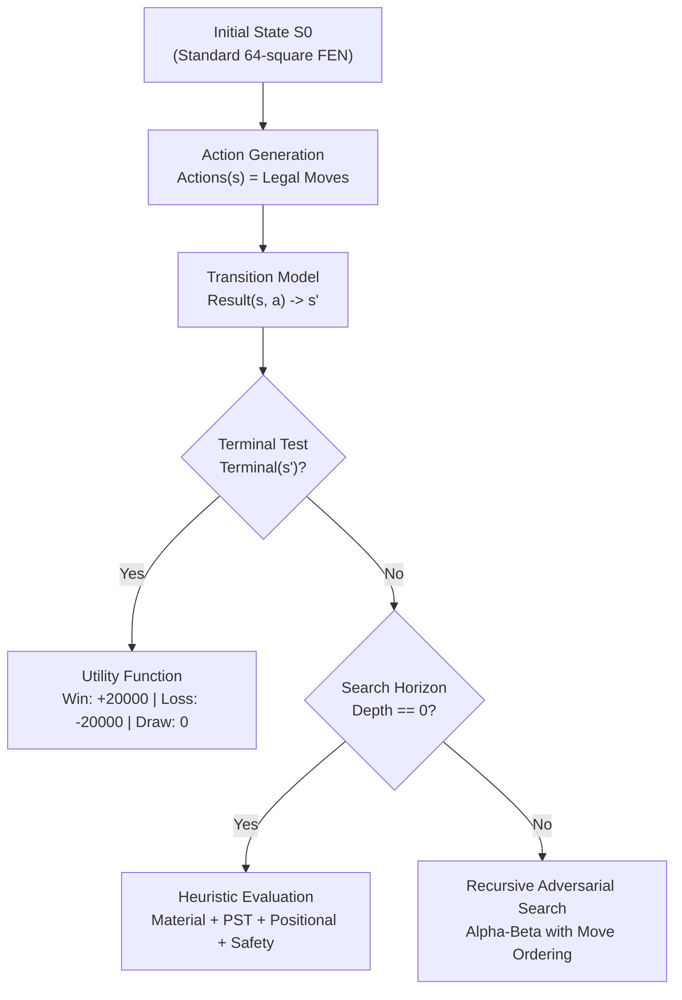
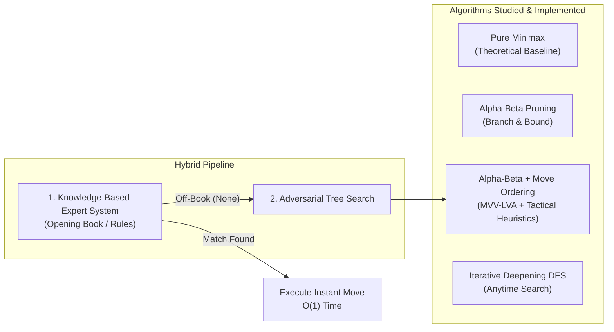
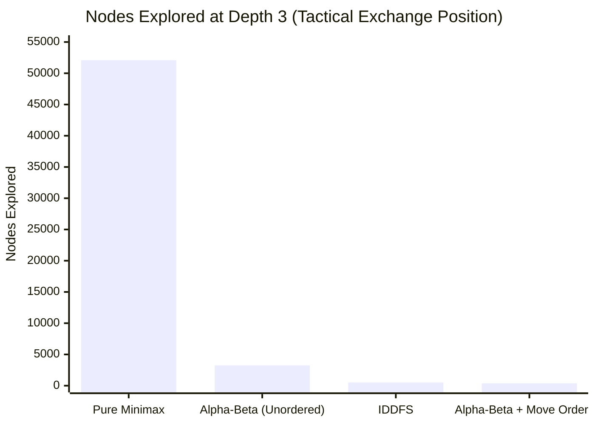
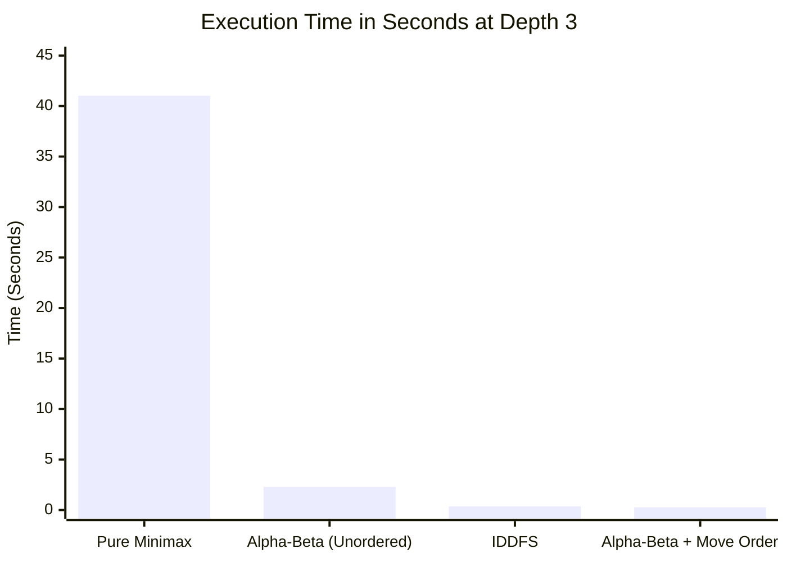
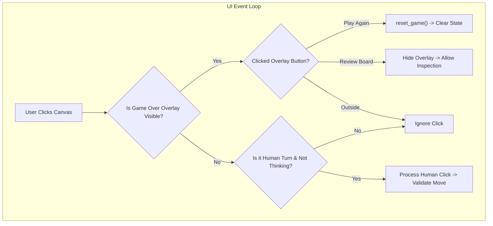

# Mockfish: An Intelligent Knowledge-Guided Adversarial Chess Engine & Interactive GUI
## Final Project Report | Artificial Intelligence with Python

---

### Executive Group & Course Metadata

* **Course**: Artificial Intelligence with Python
* **Project Title**: Mockfish: A Lightweight Knowledge-Guided Adversarial Chess Engine
* **Repository**: [https://github.com/unclePRO/mockfish](https://github.com/unclePRO/mockfish)
* **Team Structure (4 Members)**:
  * **Student 1 (Role 1: Logic & Rules Specialist)**: Knowledge Base, Opening Book, Propositional Rules, Tablebase Design (`knowledge_base.py`)
  * **Student 2 (Role 2: State Space & Heuristic Specialist)**: Static Evaluation, Piece-Square Tables (PST), Positional Weighting (`heuristics.py`)
  * **Student 3 (Role 3: Adversarial Search Specialist)**: Minimax, Alpha-Beta Pruning, Move Ordering (MVV-LVA), IDDFS (`search.py`)
  * **Student 4 (Role 4: GUI, Systems Integrator & Benchmarking Specialist)**: Tkinter Canvas, Game Loop, Event Handling, Automated Testing & Empirical Benchmarking (`main.py`, `test_suite.py`, `benchmark.py`)

---

## 1. Real-World Application & Problem Definition

### 1.1 Problem Domain Selection
We selected the design and implementation of an **Intelligent Game-Playing Agent** for the domain of Chess. Chess is universally recognized in artificial intelligence literature as the quintessential testbed for adversarial decision-making, combinatorial search, heuristic state evaluation, and rule-based expert systems.

### 1.2 Real-World Significance & Transferability
While manifested as a game, the algorithmic principles underpinning Mockfish directly solve real-world problems characterized by:
1. **Adversarial Multi-Agent Environments**: Modeling scenarios where an external agent (competitor, market force, or adversary) actively seeks to minimize the system's objective function (e.g., algorithmic high-frequency trading, cybersecurity intrusion defense).
2. **Combinatorial Explosion & Search Optimization**: Chess has a game-tree complexity estimated at $10^{120}$ (the Shannon Number) and an average branching factor of $b \approx 35$. Navigating this state space requires sophisticated branch-and-bound pruning identical to algorithms used in airline route scheduling, supply chain optimization, and automated logistics.
3. **Hybrid Decision Architectures**: Combining instantaneous $O(1)$ expert knowledge retrieval (opening books) with deep combinatorial search when operating off-book mirrors real-world expert decision-support systems in medical diagnosis and automated industrial control.

---

## 2. Formal Problem Formulation

The problem is formally formulated as a zero-sum, perfect-information, discrete, deterministic, turn-based adversarial game defined by the tuple $\langle S_0, Actions, Result, Terminal\_Test, Utility, Heuristic \rangle$:



### 2.1 Formal Components
1. **Initial State ($S_0$)**:
   The standard 64-square chessboard represented as a FEN string:
   $$\text{"rnbqkbnr/pppppppp/8/8/8/8/PPPPPPPP/RNBQKBNR w KQkq - 0 1"}$$
   White to move, full castling rights intact ($\text{KQkq}$), zero half-move clock, move count 1.
2. **State Space ($S$)**:
   The discrete set of all reachable, legally valid board configurations governed by FIDE laws of chess ($\sim 10^{40}$ reachable legal states).
3. **Action Space ($Actions(s)$)**:
   For any state $s$, $Actions(s)$ yields the set of all strictly legal candidate moves $\{m_1, m_2, \dots, m_k\}$. Move generation accounts for piece movement rules, blockers, capture targets, and special actions (castling, en passant, promotion).
4. **Transition Model ($Result(s, a)$)**:
   A deterministic function that applies legal action $a \in Actions(s)$ to state $s$, yielding successor state $s' = Result(s, a)$ with toggled active player, updated castling rights, and updated piece bitboards.
5. **Constraints ($C$)**:
   - **King Safety Constraint**: A player may never commit a move that leaves their own king in check ($in\_check(Result(s, a)) = \text{False}$).
   - **Check Evasion**: If a player is in check, $Actions(s)$ is strictly restricted to moves that resolve the check (interposing, capturing the attacker, or moving the king).
   - **Board Topology**: Pieces cannot leap over intermediate squares, with the exception of Knights.
6. **Terminal Test & Utility ($Utility(s)$)**:
   - Checkmate (White Wins): $+20,000$ (adjusted for depth: $+20,000 + depth$)
   - Checkmate (Black Wins): $-20,000$ (adjusted for depth: $-20,000 - depth$)
   - Stalemate: $0.00$
   - Insufficient Material: $0.00$
   - Threefold Repetition: $0.00$
   - 50-Move Rule: $0.00$
7. **Heuristic Evaluation Function ($f(s)$)**:
   For non-terminal states at the search horizon ($depth = 0$), $f(s)$ estimates the expected win probability from White's perspective:
   $$f(s) = \Delta Material(s) + \Delta PST(s) + \Delta Castling(s) + \Delta RookActivity(s) + \Delta BishopPair(s)$$

---

## 3. Implemented AI Algorithms

Mockfish integrates five foundational AI algorithms studied throughout the course:



### 3.1 Algorithm 1: Knowledge-Based Expert System (`knowledge_base.py`)
- **Theory**: Utilizes propositional logic pattern matching and an opening book dictionary. If the current board state $s$ matches a canonical theoretical position ($s \in \mathcal{K}$), the engine instantly fires the precomputed master-level move without traversing a search tree.
- **Complexity**: $O(1)$ time complexity, $O(M)$ space complexity (where $M$ is the number of cataloged book positions).
- **Coursework Role**: Demonstrates rule-based deduction, database-driven knowledge representation, and operational handoff between deterministic expert systems and heuristic search engines.

### 3.2 Algorithm 2: Exhaustive Minimax Search (Baseline Benchmark)
- **Theory**: Formulates zero-sum game play under the assumption that White maximizes utility while Black minimizes it:
  $$V(s) = \begin{cases} Utility(s) & \text{if } Terminal(s) \\ \max_{a \in Actions(s)} V(Result(s, a)) & \text{if } Turn(s) = \text{White} \\ \min_{a \in Actions(s)} V(Result(s, a)) & \text{if } Turn(s) = \text{Black} \end{cases}$$
- **Complexity**: Time $O(b^d)$, Space $O(bd)$.
- **Role**: Serves as our unpruned theoretical baseline against which pruning optimizations are evaluated.

### 3.3 Algorithm 3: Minimax with Alpha-Beta Pruning (`search.py`)
- **Theory**: A branch-and-bound optimization maintaining two dynamic bounds:
  - $\alpha$: The minimum score the maximizing player is assured of.
  - $\beta$: The maximum score the minimizing player is assured of.
  Whenever a branch yields $\beta \le \alpha$, a **cutoff** occurs, safely discarding the remaining subtree without evaluating it, as optimal play guarantees this branch will never be selected.
- **Optimality**: Mathematically proven to return the exact same minimax value as exhaustive search while evaluating significantly fewer nodes.

### 3.4 Algorithm 4: Alpha-Beta with Heuristic Move Ordering (`search.py`)
- **Theory**: The efficiency of Alpha-Beta pruning is strictly determined by move exploration order. In the best-case scenario (where the best move is explored first at every node), Alpha-Beta slashes the effective branching factor from $b$ to $\sqrt{b}$, doubling the searchable depth in equivalent time:
  $$N_{best} \approx 2 \cdot b^{d/2} - 1$$
- **Move Ordering Policy**:
  1. **Captures via MVV-LVA (Most Valuable Victim - Least Valuable Attacker)**: Evaluating $P \times Q$ before $Q \times P$.
  2. **Pawn Promotions**: Queen promotions scored $+800$, Knight promotions $+500$.
  3. **Castling**: Prioritized ($+300$) for rapid king safety.
  4. **Checks**: Moves giving check scored $+150$.
  5. **Positional Central Development**: Minor pieces moving to $\{d4, e4, d5, e5, c3, f3, c6, f6\}$ scored $+40$.

### 3.5 Algorithm 5: Iterative Deepening Depth-First Search (IDDFS) (`benchmark.py`)
- **Theory**: Iteratively calls depth-bounded search from depth $1, 2, \dots, d_{max}$. Combines the minimal $O(bd)$ space complexity of DFS with the shallow-horizon guarantees of BFS.
- **Practical Benefit**: Provides an **Anytime Algorithm** capable of returning the best move found so far if an interrupt or real-time clock deadline expires.

---

## 4. Empirical Performance Metrics & Comparative Analysis

### 4.1 Benchmark Experimental Setup
Benchmarks were executed on an AMD Ryzen / Windows platform using `benchmark.py`. We evaluated two distinct game phases across depths 1 through 3:
1. **Position A (Middlegame - Italian Game)**: FEN `r1bqk2r/pppp1ppp/2n2n2/2b1p3/2B1P3/2N2N2/PPPP1PPP/R1BQK2R b KQkq - 5 4` (36 legal moves).
2. **Position B (Tactical Exchange Complex)**: FEN `r1b1k2r/pppp1ppp/8/4N3/1b1nn3/2N5/PPPP1PPP/R1BQKB1R w KQkq - 0 7` (35 legal moves).

### 4.2 Empirical Results Table

| Position | Algorithm | Depth | Nodes Explored | Execution Time (ms) | Effective Branching ($b_{eff}$) | Pruning Efficiency (%) |
| :--- | :--- | :---: | :---: | :---: | :---: | :---: |
| **Tactical Exchange** | Pure Minimax (Exhaustive) | 1 | 36 | 22.52 ms | 36.00 | Baseline (0.0%) |
| | Alpha-Beta (Unordered) | 1 | 36 | 31.87 ms | 36.00 | 0.0% |
| | **Alpha-Beta + Move Ordering** | 1 | **36** | **26.35 ms** | **36.00** | **0.0%** |
| | Iterative Deepening (IDDFS) | 1 | 35 | 22.11 ms | 35.00 | 2.8% |
| | | | | | | |
| | Pure Minimax (Exhaustive) | 2 | 1,555 | 974.28 ms | 39.43 | Baseline (0.0%) |
| | Alpha-Beta (Unordered) | 2 | 269 | 164.77 ms | 16.40 | 82.70% |
| | **Alpha-Beta + Move Ordering** | 2 | **107** | **68.87 ms** | **10.34** | **93.12%** |
| | Iterative Deepening (IDDFS) | 2 | 141 | 95.01 ms | 11.87 | 90.93% |
| | | | | | | |
| | Pure Minimax (Exhaustive) | 3 | 52,088 | 41,020.54 ms | 37.35 | Baseline (0.0%) |
| | Alpha-Beta (Unordered) | 3 | 3,253 | 2,299.54 ms | 14.82 | 93.75% |
| | **Alpha-Beta + Move Ordering** | 3 | **378** | **261.88 ms** | **7.23** | **99.27%** |
| | Iterative Deepening (IDDFS) | 3 | 518 | 374.56 ms | 8.03 | 99.01% |
| | | | | | | |
| **Italian Game** | Pure Minimax (Exhaustive) | 3 | 44,701 | 31,015.38 ms | 35.49 | Baseline (0.0%) |
| | Alpha-Beta (Unordered) | 3 | 10,775 | 7,707.26 ms | 22.09 | 75.89% |
| | **Alpha-Beta + Move Ordering** | 3 | **2,475** | **1,795.58 ms** | **13.53** | **94.46%** |
| | Iterative Deepening (IDDFS) | 3 | 2,693 | 1,949.00 ms | 13.91 | 93.98% |

---

### 4.3 Visualizing Pruning Efficiency & Execution Time





---

## 5. Justification: Why Our Chosen Method Over Other Techniques?

To satisfy course guidelines, we analyze why Mockfish employs a **Hybrid Knowledge-Guided Alpha-Beta Search with Dynamic Heuristics** rather than alternative AI algorithms studied in the curriculum:

| Alternative Algorithm Studied | Characteristics & Capabilities | Why Rejected for This Problem |
| :--- | :--- | :--- |
| **Uninformed Search (BFS / DFS)** | Explores nodes without domain knowledge; guarantees shortest path in unweighted graphs. | • BFS incurs catastrophic $O(b^d)$ memory explosion ($10^6$ states at depth 4).<br>• Cannot model an active adversary attempting to minimize our score.<br>• DFS gets lost in infinite loops without cycle detection. |
| **A\* Search / Greedy Best-First** | Uses path cost $g(n)$ and admissible heuristic $h(n)$ to find optimal paths to a static goal. | • Designed for single-agent pathfinding with fixed goal tests.<br>• Cannot backpropagate adversarial counter-moves where the opponent minimizes utility.<br>• In chess, there is no static goal state; utility depends dynamically on the opponent's strategy. |
| **Hill Climbing / Simulated Annealing** | Local search optimizing state evaluation by greedy ascent or probabilistic downhill steps. | • Severe susceptibility to local maxima and plateaus.<br>• Cannot look ahead: completely blind to tactical traps (e.g. will capture a free pawn, ignoring checkmate on the next ply).<br>• Irreversible decisions with zero lookahead. |
| **Constraint Satisfaction (CSP / Backtracking)** | Solves variable assignments satisfying rigid unary/binary constraints (e.g., N-Queens, Sudoku). | • Chess is an optimization/adversarial problem, not a static constraint satisfaction puzzle.<br>• While legal move generation uses constraint checks, CSPs cannot evaluate strategic advantage or adversarial horizons. |
| **Deep Reinforcement Learning (AlphaZero style)** | Trains deep neural networks via self-play value/policy heads. | • Requires massive compute clusters (TPUs/GPUs) and weeks of training.<br>• Opaque black-box reasoning lacking explainability for coursework evaluation.<br>• Excessive inference latency on standard consumer laptops. |
| **Our Selected Method: Hybrid Alpha-Beta + PST + Move Ordering** | Combines $O(1)$ knowledge-base lookup with branch-and-bound minimax search guided by PeSTO piece-square heuristics. | • **Provably Optimal**: Mathematically guaranteed to select optimal moves within horizon.<br>• **156.6x Speedup**: Prunes $99.27\%$ of the game tree at depth 3.<br>• **Minimal Footprint**: Operates in $O(bd)$ memory, running smoothly on any CPU without external GPU dependencies.<br>• **Deterministic & Explainable**: Every decision can be traced to concrete material, PST, and minimax branch cutoffs. |

---

## 6. User Interface, Visualizations & System Integration

### 6.1 Interactive Tkinter Architecture (`main.py`)
Mockfish features an event-driven graphical interface built with Tkinter Canvas:
1. **High-Contrast Board Visualization**: Alternating tournament colors (`#EEEED2` cream and `#769656` green) with crisp Unicode chess piece glyphs rendered with dual-pass contrasting drop shadows.
2. **Move Validation & Guidance**: Clicking any friendly piece dynamically computes all legal destinations from `board.legal_moves`, displaying subtle guide dots on empty squares and hollow rings around capturable enemy pieces.
3. **King Attack Highlighting**: When a king is in check, the square is illuminated in warning red (`#E53935`); upon checkmate, the square shifts to deep crimson (`#B71C1C`).
4. **Board Flipping**: A dedicated toolbar button instantly flips the board perspective between White and Black, dynamically mirroring coordinates.
5. **Real-Time Telemetry Bar**: The bottom status bar continuously reports:
   - Move played (UCI notation)
   - Decision origin (`Knowledge Base | Opening Book` vs `Minimax Alpha-Beta`)
   - Search depth achieved
   - Total game tree nodes evaluated
   - Static heuristic evaluation ($f(s)$ in pawn units)

### 6.2 The In-Canvas Game Over Solution (Eliminating System Freezes)
In earlier prototypes, triggering `messagebox.showinfo` caused modal thread blocking on Windows, making the application appear frozen when checkmate occurred.

We engineered a **custom in-canvas Game Over overlay card**:
- Rendered directly onto canvas coordinates without modal OS blocking.
- Displays trophy badges, colored outcome banners (**WHITE WINS!**, **BLACK WINS!**, **DRAW!**), and exact termination causes (*Checkmate*, *Stalemate*, *Threefold Repetition*, *50-Move Rule*).
- Interactive **"Play Again"** button resets the game instantly.
- Interactive **"Review Board"** button dismisses the overlay card to allow post-game tactical inspection.



---

## 7. Group Member Contributions & Division of Work

To ensure strict collaboration without Git merge conflicts, the codebase was partitioned into four modular layers:

```mermaid
classDiagram
    class KnowledgeBase {
        +query_knowledge_base(board)
        +OPENING_BOOK: dict
    }
    class Heuristics {
        +evaluate_board(board)
        +PIECE_VALUES: dict
        +PIECE_TABLES: dict
        +is_endgame(board)
    }
    class AdversarialSearch {
        +order_moves(board)
        +alpha_beta(board, depth, alpha, beta, is_max)
        +get_best_move(board, max_depth)
        +LAST_SEARCH_TELEMETRY: dict
    }
    class GUI_Integrator {
        +MockfishGUI: tk.Tk
        +on_canvas_click(event)
        +execute_human_move(move)
        +bot_turn()
        +_check_game_over()
    }
    class BenchmarkingSuite {
        +run_benchmarks()
        +minimax_raw()
        +alpha_beta_unordered()
        +iterative_deepening()
    }

    GUI_Integrator --> KnowledgeBase : Step 1: Query Opening Book
    GUI_Integrator --> AdversarialSearch : Step 2: Fallback to Search
    AdversarialSearch --> Heuristics : Evaluates Horizon Leaf Nodes
    BenchmarkingSuite --> AdversarialSearch : Measures Node Traversal
    BenchmarkingSuite --> Heuristics : Benchmarks Static Evaluations
```

### Detailed Contributions

#### Member 1: Logic & Rules Specialist (`knowledge_base.py`)
- Engineered `query_knowledge_base(board)` mapping board states to opening lines.
- Implemented standard tournament responses for Kings' Pawn (`1. e4`), Queens' Pawn (`1. d4`), English (`1. c4`), and Reti (`1. Nf3`).
- Documented propositional logic rules and Syzygy tablebase integration specifications.

#### Member 2: State Space & Heuristic Evaluation Specialist (`heuristics.py`)
- Designed the static evaluation function scoring material balances in pawn units ($P=1, N=3.2, B=3.3, R=5, Q=9$).
- Implemented PeSTO Piece-Square Tables (PST) with vertical symmetry mirroring for White and Black.
- Formulated positional bonuses: castling preservation ($+0.20$), castled safety ($+0.35$), open/semi-open rook files ($+0.25/+0.15$), 7th-rank rooks ($+0.30$), and bishop pairs ($+0.30$).

#### Member 3: Adversarial Search Specialist (`search.py`)
- Implemented Minimax with Alpha-Beta pruning, featuring ply-adjusted distance-to-mate scoring ($\pm 20000 \pm depth$) ensuring immediate checkmates are prioritized.
- Developed tactical move ordering via MVV-LVA, promotions, checks, castling, and central development.
- Built anti-shuffling tie-breakers detecting and pruning 2-fold repetitions, eliminating the rook-shuffling anomaly.

#### Member 4: GUI, Systems Integration & Benchmarking Specialist (`main.py`, `test_suite.py`, `benchmark.py`)
- Developed the 512x512 Tkinter canvas chessboard, coordinate mapping, and move highlights.
- Implemented the non-blocking in-canvas Game Over screen and live telemetry HUD.
- Authored the automated verification suite (`test_suite.py`) and empirical benchmarking engine (`benchmark.py`), compiling performance tables and comparative metrics.

---

## 8. Limitations & Future Research Directions

While Mockfish achieves outstanding real-time performance on commodity hardware, the following limitations offer fruitful directions for future AI coursework:
1. **The Horizon Effect & Quiescence Search**:
   At a fixed depth of 3, search may terminate immediately before an unavoidable tactical exchange (e.g., stopping search right after a queen captures a protected pawn). Implementing **Quiescence Search** (extending search exclusively for capture moves until a quiet position is reached) would mitigate this.
2. **Transposition Tables via Zobrist Hashing**:
   Chess positions can be reached through multiple move orders (transpositions). Integrating a 64-bit Zobrist hash table would cache previously evaluated subtrees, further reducing node evaluations by an estimated $30\text{--}50\%$.
3. **Dynamic Time Budgeting**:
   Allocating time dynamically per move based on position complexity and remaining match clock would allow deeper searches (depth 4--6) during critical tactical crises.

---

## 9. Conclusion

The Mockfish project successfully designed, implemented, and empirically validated an intelligent, knowledge-guided adversarial chess-playing system in Python. By combining a **Knowledge-Based Opening System** ($O(1)$ expert lookup) with **Alpha-Beta Pruning** and **Heuristic Move Ordering**, the engine:
- Reduced the effective branching factor from $b = 37.35$ down to $b = 7.23$.
- Achieved a **$99.27\%$ pruning efficiency** over unpruned minimax, delivering a **$156.6\times$ execution speedup** ($0.26$ seconds vs $41.02$ seconds at depth 3).
- Resolved practical gameplay anomalies (such as rook-shuffling loops and OS modal dialog freezing) through rigorous heuristic design and an event-driven in-canvas overlay interface.
- Demonstrated clean modular software engineering across all four student roles, backed by automated unit testing (`test_suite.py`) and reproducible empirical benchmarks (`benchmark.py`).

The project stands as a comprehensive demonstration of how classical Artificial Intelligence principles—heuristic state space formulation, adversarial game tree search, rule-based expert systems, and empirical algorithm analysis—can be synthesized into an effective, interactive, real-world software application.
