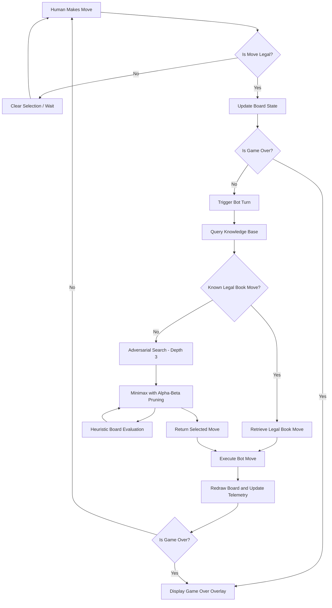

# Mockfish AI Chess Engine

Mockfish is a lightweight, modular chess engine with an interactive Tkinter GUI, developed using Python and the `python-chess` library.

The project combines knowledge-based decision-making, adversarial search and heuristic evaluation to play chess against a human opponent. It also compares different search methods based on execution time and the number of explored nodes.

---

## AI Algorithms and Techniques

- **Knowledge-Based Decision-Making:** Opening book retrieval using FEN-based position matching.
- **Minimax Search:** Depth-limited adversarial search used as a baseline for performance comparison.
- **Alpha-Beta Pruning:** Reduces the number of explored nodes by pruning branches that cannot improve the minimax value.
- **Heuristic Move Ordering:** Prioritizes promising moves to improve pruning efficiency.
- **Iterative Deepening Search:** Progressively searches from depth 1 to a specified maximum depth.
- **Heuristic Evaluation:** Evaluates board positions using material balance, Piece-Square Tables (PST) and positional features.

The playable engine uses knowledge-based opening retrieval and fixed-depth Alpha-Beta search with heuristic move ordering at a depth of 3 plies. Pure Minimax and Iterative Deepening are implemented separately in `benchmark.py` for comparative performance analysis.

---

## Features

- Interactive human-versus-AI chess gameplay.
- Legal move generation and validation.
- Opening book for common chess openings.
- Minimax search with Alpha-Beta pruning and heuristic move ordering.
- Material and positional board evaluation.
- Repetition-aware search and depth-adjusted checkmate scoring.
- Legal move and capture indicators, check and checkmate highlighting.
- Board flipping and game restart.
- Interactive Game Over overlay with Play Again and Review Board options.
- Search telemetry displaying move, depth, explored nodes and evaluation.
- Algorithm benchmarking and automated testing.

---
### Supporting Files

| File | Purpose |
| :--- | :--- |
| `benchmark.py` | Compares the performance of different adversarial search methods. |
| `test_suite.py` | Contains unit and integration tests for the application. |
| `requirements.txt` | Specifies the required Python dependency. |
| `.gitignore` | Excludes unnecessary local and generated files. |

---

## Quickstart

### 1. Prerequisites

- Python 3.10 or later.
- Tkinter (normally included with Python on Windows and macOS).
- Git (optional, for cloning the repository).

### 2. Clone the Repository

```bash
git clone https://github.com/unclePRO/mockfish.git
cd mockfish
```

### 3. Install Dependencies

```bash
python -m pip install -r requirements.txt
```

### 4. Run Mockfish

```bash
python main.py
```

The human player plays as White, while Mockfish plays as Black. Select a piece and click a highlighted legal destination to make a move. The engine responds using either its opening book or adversarial search.

### 5. Run the Full Test Suite

```bash
python test_suite.py
```

The five test groups cover knowledge-base retrieval, heuristic evaluation, adversarial move selection and repetition handling, selected-move correctness and board restoration, and GUI functionality. GUI integration tests require a graphical desktop environment. All five groups passed in the recorded local test run.

### 6. Run Individual Module Self-Tests

```bash
python knowledge_base.py
python heuristics.py
python search.py
```

### 7. Run Algorithm Benchmarks

```bash
python benchmark.py
```

The benchmark compares four search configurations across two chess positions at search depths 1, 2 and 3.

---

## System Architecture

1. The human player makes a legal move through the GUI.
2. The updated board position is passed to the knowledge base.
3. If a matching opening position exists and its stored move is legal, the move is returned.
4. Otherwise, the engine performs Alpha-Beta search with heuristic move ordering.
5. Non-terminal positions at the search horizon are evaluated using the heuristic evaluation function.
6. The selected move is executed, and the GUI and telemetry are updated.

### Architectural Flowchart



---

## Heuristic Evaluation

The evaluation function scores a position from White's perspective.

| Piece | Material Value |
| :--- | ---: |
| Pawn | 1.00 |
| Knight | 3.20 |
| Bishop | 3.30 |
| Rook | 5.00 |
| Queen | 9.00 |

Material evaluation is supplemented by Piece-Square Tables, separate middlegame and endgame king tables, castling rights and king-position bonuses, open and semi-open rook file bonuses, seventh-rank rook activity and bishop-pair bonuses.

A positive evaluation indicates an advantage for White, while a negative evaluation indicates an advantage for Black. Terminal checkmate and draw conditions are evaluated separately. Root-level repetition tie-breaking verifies possible equal cutoff scores before preferring a non-repeating move.

---

## Performance Comparison

Four configurations are evaluated: Pure Minimax, unordered Alpha-Beta, ordered Alpha-Beta and Iterative Deepening using ordered Alpha-Beta.

### Tactical Exchange Position

Recorded results at search depth 3:

| Search Method | Nodes Explored | Execution Time (ms) |
| :--- | ---: | ---: |
| Pure Minimax | 52,088 | 23,122.83 |
| Alpha-Beta (Unordered) | 3,253 | 1,322.00 |
| **Alpha-Beta + Move Ordering** | **378** | **163.13** |
| Iterative Deepening | 521 | 203.70 |

### Italian Game Middlegame Position

Recorded results at search depth 3:

| Search Method | Nodes Explored | Execution Time (ms) |
| :--- | ---: | ---: |
| Pure Minimax | 44,701 | 19,625.57 |
| Alpha-Beta (Unordered) | 10,775 | 4,113.20 |
| **Alpha-Beta + Move Ordering** | **2,475** | **1,024.08** |
| Iterative Deepening | 2,696 | 1,121.21 |

### Key Observations

Compared with pure Minimax, ordered Alpha-Beta achieved:

| Metric | Tactical Exchange | Italian Middlegame |
| :--- | ---: | ---: |
| Reduction in Explored Nodes | 99.27% | 94.46% |
| Execution Speedup | 141.74x | 19.16x |

All configurations use the same static evaluation and terminal policy, including twofold repetition as a search heuristic. Root visits are counted consistently, including each iteration of iterative deepening. All four methods agreed on the minimax evaluation at all six tested position-depth combinations.

At depth 1, all methods visit the same number of nodes; heuristic ordering adds overhead without pruning savings. At depths 2 and 3, pruning and ordering reduced the computational cost in these tests. Execution times are single-run measurements and depend on hardware, board position and search depth. They do not measure playing strength.

---

## Why Alpha-Beta with Move Ordering?

Chess is a two-player adversarial game with a large branching factor. Conventional single-agent search and local optimization methods do not directly account for an opponent's strategic responses.

Minimax provides an adversarial decision-making framework, but exhaustive exploration becomes computationally expensive as depth increases. Alpha-Beta pruning reduces unnecessary exploration, while heuristic move ordering improves the likelihood of early cutoffs.

This combination was selected for the playable engine because it offers a practical balance between search depth, computational cost and decision quality.

---

## Limitations and Future Work

### Current Limitations

- Fixed search depth of 3 plies during gameplay.
- Limited opening book coverage.
- Horizon effect caused by depth-limited search.
- Handcrafted heuristic evaluation.
- No position caching or transposition tables.
- Search computation may temporarily block GUI interaction.
- Limited benchmark positions and single-run timing measurements.

### Future Improvements

- Quiescence search to mitigate the horizon effect.
- Transposition tables using Zobrist hashing.
- Dynamic search depth and time management.
- Expanded opening book coverage and endgame tablebase integration.
- Improved evaluation and move-ordering techniques.
- Broader correctness testing and repeated performance trials.

---

## Conclusion

Mockfish demonstrates classical AI techniques for adversarial game-playing through a functional Python chess engine. In the recorded depth-3 benchmarks, Alpha-Beta pruning with heuristic move ordering substantially reduced explored nodes and execution time compared with exhaustive Minimax while preserving the tested minimax values.

The project integrates knowledge-based decision-making, adversarial search, heuristic evaluation and an interactive graphical interface into a modular application.
