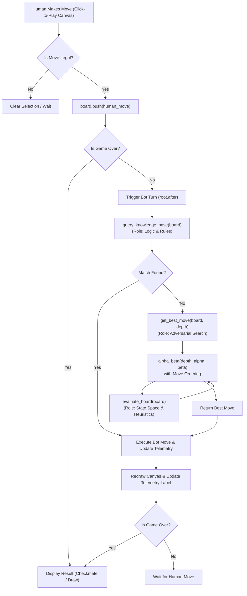

# Mockfish AI Chess Engine

A lightweight, modular AI chess engine and Tkinter GUI built with Python and the `python-chess` library for university coursework.

Demonstrates core Artificial Intelligence syllabus topics:
- **Knowledge Bases & Expert Systems** (Opening books, Propositional / FOL rule bases)
- **Adversarial Search** (Minimax, Alpha-Beta Pruning, Move Ordering, Iterative Deepening)
- **Heuristics & Evaluation** (Material balance, Piece-Square Tables, Mobility, Positional features)
- **Interactive UI & Systems Integration** (Event-driven Tkinter GUI, Telemetry, Game Loop)

---

## Team Division & Role Ownership

To prevent Git merge conflicts, the codebase is strictly separated into four self-contained modules corresponding to each team member's role:

| File | Role / Domain | Core Responsibilities & Next Steps |
| :--- | :--- | :--- |
| **`knowledge_base.py`** | **Role 1: Logic & Rules** | • Opening book lookups (`chess.polyglot` / SQLite / dictionary)<br>• Propositional / First-Order Logic (FOL) safety & endgame rules<br>• Endgame tablebase queries (`chess.syzygy`) |
| **`heuristics.py`** | **Role 2: State Space & Heuristics** | • Piece-Square Tables (PST) for midgame and endgame<br>• Positional evaluation: mobility, center control, king safety<br>• Pawn structure evaluation: doubled, isolated, and passed pawns |
| **`search.py`** | **Role 3: Adversarial Search** | • Minimax with Alpha-Beta pruning<br>• Advanced move ordering (MVV-LVA, Killer Moves, History Heuristic)<br>• Iterative Deepening DFS (IDDFS) & Quiescence Search<br>• Transposition Tables (Zobrist Hashing) |
| **`main.py`** | **Role 4: GUI & Integrator** | • Tkinter GUI canvas, coordinate mapping, and rendering<br>• Click-to-play event loop and legal move highlighting<br>• Game loop orchestration (Knowledge Base $\rightarrow$ Search $\rightarrow$ Move Execution)<br>• Telemetry bar and match statistics |

---

## Quickstart

### 1. Prerequisites
- Python 3.10+
- Tkinter (standard with Python on Windows/macOS)

### 2. Install Dependencies
```bash
pip install -r requirements.txt
```

### 3. Run Mockfish
```bash
python main.py
```

### 4. Run Individual Module Self-Tests
Each file has a built-in `if __name__ == "__main__":` test block so teammates can test their individual module without launching the full GUI:

```bash
# Test Role 1 (Knowledge Base)
python knowledge_base.py

# Test Role 2 (Heuristics)
python heuristics.py

# Test Role 3 (Adversarial Search)
python search.py
```

---

## Architectural Flowchart



---

## Git Workflow to Avoid Merge Conflicts

1. **Work in your assigned file:** Avoid making changes outside your designated module.
2. **Contract-first interfaces:** The signatures of `query_knowledge_base(board)`, `evaluate_board(board)`, and `get_best_move(board, max_depth)` are locked. Teammates can add helper functions and classes inside their files freely.
3. **Commit often with descriptive prefixes:**
   - `feat(logic): add polyglot opening book reader`
   - `feat(heuristics): add piece-square tables`
   - `feat(search): add iterative deepening with 2s timeout`
   - `feat(gui): add promotion choice modal dialog`
